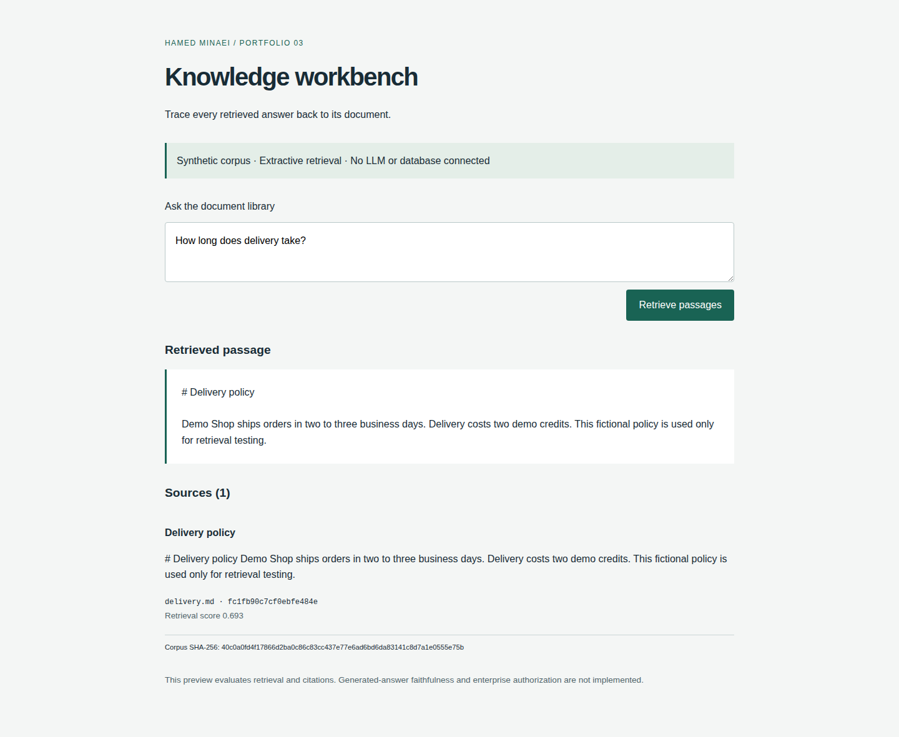

# Knowledge Workbench

A modernized, evidence-first document retrieval portfolio project by Hamed Minaei, derived from Supabase's Next.js doc-search template.

**Status: extractive portfolio preview, not a complete enterprise RAG service.** The working runtime uses local document ingestion and deterministic lexical retrieval. It does not create embeddings, call an LLM, connect to Supabase, or provide enterprise authorization. The original cloud integration is preserved under `legacy/` for attribution and migration reference, and is excluded from the new runtime.

## Architecture

| Component | Responsibility |
| --- | --- |
| `lib/ingestion.ts` | Bounded local Markdown/text ingestion; no URL fetches or symlink following |
| `lib/retrieval.ts` | Stable chunk identities, Unicode tokenization, scored retrieval, citations and evaluation |
| `scripts/` | Ingestion, evaluation and built-server HTTP verification |
| `app/` | Next.js workbench and validated, size-limited search API over synthetic examples |
| `legacy/` | Preserved upstream application, old dependencies and Supabase schema; not installed or executed by current commands |

The browser/API uses the checked-in synthetic `examples/index.json`. CLI-created `.data/index.json` is separate; importing arbitrary private documents into the public demo is deliberately unsupported. RAG generation, embedding quality and model faithfulness need a separately authorized, disposable provider integration before they can be evaluated.

## Features

- Markdown/text folder ingestion, deterministic corpus hashes, stable source IDs and Unicode-aware overlapping chunks.
- Document, chunk and request limits; hidden-file exclusion and symlink rejection.
- Retrieved passages with document title, source path, chunk offset and ranking score.
- Explicit abstention for questions with no matching tokens.
- Reproducible evaluation of expected-source ranking and correct abstention.
- Updated root runtime: Next.js 16.4.2, React 19.3.1 and TypeScript 5.9.3; pinned dependencies and lockfile.
- Responsive UI, automated policy tests, HTTP smoke tests and browser screenshot scenarios.

This is lexical retrieval, not vector/semantic search. Its toy evaluation scores are not evidence of production retrieval effectiveness.

## Installation

Requires Node.js 24 and pnpm 10.32.1.

```bash
pnpm install --frozen-lockfile --ignore-scripts
pnpm test
pnpm dev
```

Open `http://127.0.0.1:3000`. No API key or database is needed. All included documents are fictional.

## Configuration

The current runtime reads no environment variables; `.env.example` states this explicitly. Do not add production credentials.

```bash
pnpm ingest examples/documents .data/index.json
pnpm evaluate
```

Ingestion accepts at most 100 `.md`/`.txt` documents of 200 KB each and 5000 chunks. Default chunks contain 600 Unicode codepoints with 100-codepoint overlap. Regenerate the synthetic browser corpus explicitly with `pnpm ingest examples/documents examples/index.json`. CLI output paths are local files and may be replaced by subsequent runs.

## Security

The public search endpoint reads only the bundled fictional corpus and rejects requests over 4096 bytes, malformed JSON and invalid questions. No remote ingestion, model tools, SQL, file download or production connection is exposed. Source text is rendered as React text. Local ingestion never follows symlinks.

There is no identity, access-control layer, rate limiter, persistent multi-user storage or tenant boundary. Do not deploy with confidential documents. The legacy service-role API and old dependencies are archived, not security-approved or modernized in place. Never run `legacy` in a production environment.

The root dependency audit initially reported zero known advisories. Rerun `pnpm audit` before release. Retain dependency license notices and review their inventory; Apache permission on the repository does not relicense dependencies.

## Testing

```bash
pnpm test
pnpm typecheck
pnpm evaluate
pnpm build
node scripts/smoke.mjs
pnpm exec playwright install --with-deps chromium
pnpm exec playwright test
pnpm audit --audit-level high
```

Seven tests exercise deterministic ingestion, chunk boundaries, Unicode, unsafe sources, symlinks, stale identities, citations and evaluation. HTTP checks cover citations, abstention, invalid JSON, request limits and unsupported methods. Browser tests exercise desktop/mobile retrieval and emit real screenshots as CI artifacts. Local browser execution remains unavailable in this environment; do not treat authored tests as passing until CI confirms them.

`examples/evaluation-results.json` records a three-case synthetic evaluation: expected-source retrieval and abstention accuracy 1.0, MRR 1.0. These only verify the tiny fixture. They do not measure generated-answer faithfulness or real-world performance.

## Demo

Ask “How long does delivery take?”, inspect the cited Delivery policy, then ask “quantum telescope orbit” to observe abstention. Run ingestion and evaluation from the commands above. No live model, hosted deployment or embedding demo is claimed.

## Attribution

Derived from [supabase-community/nextjs-openai-doc-search](https://github.com/supabase-community/nextjs-openai-doc-search), baseline `50d6bb71706b50a83c2a52dc4a7d3e426ac34adf`. Its complete source, original README, Supabase schema and configuration remain under `legacy/`, and the original Apache-2.0 LICENSE and Git history are retained.

Hamed Minaei's work is the modern root runtime, ingestion/retrieval/evaluation modules, new UI/API, synthetic corpus, tests and CI. This change replaces the runnable legacy application with a credential-free retrieval workbench; it does not claim that the old cloud API was ported or validated. See [verification](docs/VERIFICATION.md) and [NOTICE](NOTICE).

## Verified browser screenshots

Captured by Playwright in GitHub Actions against the synthetic corpus.



[Mobile screenshot](docs/screenshots/knowledge-320.png)
